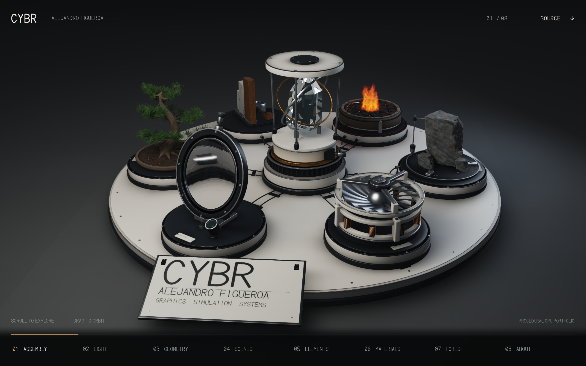
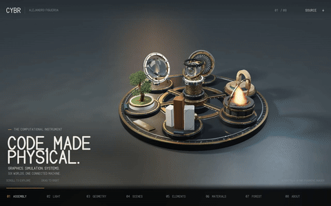

# CYBR Computational Instrument

A procedural portfolio presented as an eight-chapter instrument: assembly, light, geometry, scenes, elements, materials, forest and identity. This repository preserves the project's source lineage. **Start with Instrument Rebuild**, the latest reconstruction of the six exhibits, shared chassis and central instrument. Procedural Workshop, Asset Rebuild, Mobile Recovery, Precision Lab and the original single-shader version remain separate historical checkpoints.



[Current implementation guide](instrument-rebuild/README.md) · [Six-exhibit review sheet](instrument-rebuild/verification/exhibit-review.jpg) · [Native portrait capture](instrument-rebuild/verification/portrait-native.png) · [Current browser report](instrument-rebuild/verification/test-report.json) · [Geometry/bake audit](instrument-rebuild/verification/geometry-audit.json)

These are supplied browser-canvas captures from Chromium/ANGLE/Mesa software graphics, not physical-phone screenshots, generated concept art or new renders made during publication preparation. Eight native 2560×1600 views are accompanied by a capture record with their hashes. The labeled exhibit sheet is a layout of current views, **not a before/after comparison**. Older Workshop/Asset Rebuild images remain historical, not presented as this revision.

## Portable setup and verification

Python 3.10+ builds the viewer on Windows, macOS and Linux. From a new checkout:

    python restore_assets.py
    python instrument-rebuild/build.py

Open instrument-rebuild/dist/index.html directly in a WebGL2 browser. Cache restoration verifies every part and final SHA-256. Windows filesystems without hard links use atomic, non-overwriting rename; access-denied errors and conflicting files still fail. UTF-8 text and LF output are explicit.

For bounded browser checks and geometry validation:

    python -m pip install --no-compile numpy Pillow playwright
    python -m playwright install chromium
    python -m unittest discover -s tests -v
    python instrument-rebuild/studio/audit_geometry.py
    python tools/browser_smoke.py

The browser launcher uses Playwright's installed Chromium, an explicit CYBR_BROWSER_PATH, or a discovered Chrome/Edge executable. Headless operation needs no Xvfb. CYBR_SOFTWARE_GL=1 explicitly selects SwiftShader for CI; reports retain the actual renderer identity. Desktop and touch-layout screenshots are diagnostic captures, not physical-phone benchmarks.

Optional native bakers use a C++17 compiler and CMake:

    cmake -S . -B output/native-build
    cmake --build output/native-build --config Release --parallel 2

OpenMP is used when found; otherwise loops compile serially with unchanged sampling. On Windows the executables are normally in output/native-build/Release; single-configuration generators place them in output/native-build. Full cache regeneration still requires the authoring dependencies and significant computation. The historical checkpoints remain separate.

The GitHub workflow runs cache integrity, build, geometry, native compilation and bounded viewer checks on Windows, macOS and Linux. A configured workflow is not a recorded pass until its run completes. Portable launch/source changes do not establish physical mobile speed, photographic quality or new cache-bake correctness.

## Start here

```bash
# From the repository root, before any current or historical build/run:
python restore_assets.py
cd instrument-rebuild
python build.py
```

Nine oversized derived caches are distributed as exact byte-split parts under `transport/parts/`, each at most 8 MiB. The standard-library restoration helper checks every part and each final byte count/SHA-256 against [the transport manifest](transport/cache-parts.json), then restores the original paths. Existing exact files are verified and left alone; differing files are never overwritten. Run it after a fresh checkout, before any build or run. This is lossless transport packaging, not asset reduction: geometry, material data, lighting values, source manifests and the historical 26-second GIF are unchanged. Restored raw copies are ignored by Git. The helper requires Python 3.9 or newer.

Open the resulting `instrument-rebuild/dist/index.html` in a WebGL2-capable browser. Assembly from included compressed caches uses only Python's standard library. No server, CDN, API key, external font or account is required at runtime. Generated standalone HTML is omitted from publication; editable source and all build-input caches are included.

Scroll/swipe through chapters, drag to orbit, or use keyboard/chapter buttons. **Animation begins paused by default**; explicit `?animate=1` can opt into animation unless reduced-motion applies. A stationary view takes **eight subpixel-offset raster frames**, then stops scheduling draws. Camera changes reset that history, and Play runs the mechanisms/flame continuously. This is bounded edge antialiasing, not path-traced convergence or increasing light bounces. Diagnostics label paused cadence as refining/idle instead of animation FPS. Context restoration pauses animation.

Native device pixels are the default. Diagnostics expose copy/download/selectable reports, explicit 75%/50% resolution choices, context-loss details and recovery controls. Browser allocation limits and the 320 MiB application-resource guard are separate. These controls are not a physical-device performance guarantee.

## Six separate checkpoints

- [instrument-rebuild/](instrument-rebuild/README.md): latest source. Rebuilt exhibits and chassis, corrected optical alignment/normal orientation, geometry pine needles, fitted finite-area lighting, dedicated optical captures and stationary raster edge refinement. This is the documented default.
- [history/procedural-workshop/](history/procedural-workshop/README.md): preceding stone/tree/material revision, with optional bounded MSAA at modest viewports and a 214.68 MiB portrait allocation estimate. Its startup animation and antialiasing behavior are not the current version's.
- [history/asset-rebuild/](history/asset-rebuild/README.md): earlier asset reconstruction, including tree/stone rebuilds, turbine supports/windings, compact offline flow/flame and a 210.14 MiB estimate.
- [history/mobile-recovery/](history/mobile-recovery/README.md): memory/workload repair retaining the earlier geometry, packed RGB9_E5 environment/probe caches and a 188.12 MiB estimate.
- [history/precision-lab/](history/precision-lab/README.md): heavy multi-pass mesh/Studio checkpoint with editable authoring tools and complete caches. Retained for provenance/reuse, not the recommended mobile default. Its allocation path was implicated in reported context loss, but the browser did not establish the physical-device root cause.
- [history/original-shader/](history/original-shader/README.md): earlier single-fragment reconstruction, with readable GLSL modules, build and offline-render tools. Not the later mesh renderer or the separate IRIS study.

These are source checkpoints in one repository, not six independently maintained products. Do not overlay runtime files or interchange architectures, resource budgets and verification reports.

## What Instrument Rebuild changes

The current mesh contains **1,047,596 triangles and 583,488 stored vertices**. Its uncompressed SHA-256 is `a38a0977b29172e0e71534b44addd4863460a5615ca3350060c0f5d5262d74b5`. The header, indices, byte count and hash were independently checked during publication preparation. A smaller triangle count than Workshop is not proof of faster rendering.

- The shared platter, recessed hardware, supported identity plate, cable runs, central bearing housing, rods, gimbals and optical core are reconstructed as connected visual structures.
- The optical station has a kinematic mount, baffle, retaining shoulder and adjustment hardware. The analytic biconvex lens axis matches its mounting transform. Refraction samples dedicated scene-local captures rather than marching through discontinuous screen-depth crossings. The crystal uses its generated convex planes, with up to four internal interfaces before a fallback.
- The compressor has 19 cambered, finite-thickness airfoils, a revolved spinner, casing ribs, three bearing bridges and nine stator teeth. Normal orientation was corrected before the recorded final bake. These are authored visual mechanisms, not torque-rated or manufacturing-ready designs.
- Fractured slate has unequal cleavage planes, flake loss, chips and a holding fixture. The crucible has refractory thickness and irregular crust plates; the source normalizes cell winding, and the supplied audit reports no inward-facing exposed tops.
- Material coupons have visible thickness/mounting and differentiated finishes. Walnut uses growth coordinates, marble has sparse seams, and metal/coating responses are separated. The generator starts from the included texture arrays, so complete regeneration still requires those input arrays.
- The forest is now an authored pine/bonsai: tapered trunk, unequal branches, shoots, paired bent needles with geometry cross-sections, buds and mineral soil. It does not use transparent foliage cards or a scanned model.
- A small numerical GGX lighting lookup, its fitting script and residual statistics are included. It approximates finite rectangular-light reflection; it is not an exact anisotropic reference solver.

Direct/ambient visibility and approximate one-bounce diffuse light are baked for the rest pose. Seven 256-pixel reflection captures and two 512-pixel optical capture sets record the current geometry hash. Analytic glass is absent from the opaque capture pass. The inherited 48-frame RG8 temperature/density cache still uses 6 MiB of GPU storage and a 7.92-second loop with a six-volume crossfade. This is artist-directed, simplified fire, not a new validated combustion simulation.

The runtime keeps two shader draw passes: opaque surfaces, then optics/flame/display/interface composition. **There are no MSAA renderbuffers in Instrument Rebuild.** One native RGB8 history serves only the eight-frame stationary edge resolve. No triangle BVH, full-scene GPU path tracer, progressive lighting history, HDR denoiser or depth-of-field pass is allocated. Offline CPU baking may use a BVH without uploading it to the browser.

## Resource estimates, not hardware measurements

At 1440×2654 with HDR color, the source-derived application texture/buffer estimate is **248,699,008 bytes (237.18 MiB)**. This includes:

- Native color/depth targets: **45,861,120 bytes (43.74 MiB)**.
- RGB8 stationary edge history: **11,465,280 bytes (10.93 MiB)**.
- Dedicated optical captures: **16,777,200 bytes (about 16 MiB)**.
- Fitted area-light lookup: **16,384 bytes**.
- Mesh/index buffers, irradiance, environment/reflection probes, surface arrays, noise and flame data.

The supplied software-browser ledger records matching intercepted allocation sizes. Browser presentation surfaces, driver alignment/metadata, shader programs, transient uploads and HTML/JavaScript memory are excluded. **This is not measured physical VRAM or available device memory.**

At the same resolution, Workshop estimates **214.68 MiB**, Asset Rebuild **210.14 MiB**, Mobile Recovery **188.12 MiB**, and Precision Lab's older Studio path **606.15 MiB**. Workshop's 1,207,464 triangles / 664,242 vertices, Asset Rebuild's 1,053,109 / 578,930, and Mobile Recovery's 1,765,775 / 969,041 are historical figures, not the current geometry.

## Edit and regenerate

- `instrument-rebuild/host.html` and `shaders/`: lifecycle, native-size targets, paused raster-AA scheduling, optics, surface shading and display.
- `instrument-rebuild/studio/geometry.py`, `rebuild_instruments.py` and `natural_assets.py`: geometry construction, hardware, pine/slate and packing.
- `instrument-rebuild/studio/rebuild_surface_maps.py`, `fit_area_lights.py` and `bake_flame.py`: authored surface fields, numerical light fitting and inherited procedural flow.
- `instrument-rebuild/studio/`: C++ illumination bakers, packers, environment/probe/optical capture tools and verification.

Follow the [current authoring order](instrument-rebuild/README.md), not an older checkpoint's commands. Full regeneration needs NumPy, SciPy, scikit-image, trimesh, Pillow, Playwright, Chromium and a C++17 compiler; OpenMP is optional. Current Instrument Rebuild tools use portable browser discovery and CMake. Historical checkpoints retain their original runtime assumptions. Included captures bootstrap browser rebuilding before capture regeneration; final geometry/cache hashes must agree. Floating-point/compiler differences can alter regenerated bytes. Building the HTML from supplied caches is distinct from regenerating those caches.

## Actual historical shader preview



[Original 26-second, 1280×800, 24-FPS MP4](media/original-shader-26s.mp4). The 480×300, nominal 6-FPS GIF retains the film's 26-second timeline. This depicts the earlier shader lineage, **not Instrument Rebuild, Workshop, Asset Rebuild or Mobile Recovery**. Visual/source chapter correspondence was inspected previously; the film has no embedded source hash proving a byte-exact code-to-film match.

## Windows portability verification, 22 October 2026

A fresh checkout now restores all nine caches on this Windows drive, builds the viewer, passes all nine geometry checks, compiles both C++ bakers with MSVC, and runs each baker on a deterministic triangle with one and two threads. Real desktop and emulated touch viewport checks pass on Intel UHD graphics; no physical phone benchmark is claimed. [Commands, captures and limitations](verification/windows-portability/README.md). Three-OS CI is configured; its results are pending the first remote run.

The separately reported newer Causal Bench source has not been inspected or imported here. This evidence concerns Instrument Rebuild, not that newer revision.

## Verification and honest limits

The latest supplied reports record **39/39 software-browser checks and 9/9 geometry/bake checks**. These cover actual chapter rendering, native portrait pixels, allocation interception/guards, input, diagnostics, clipboard-denied fallback, deliberate context loss/restoration, HDR-extension fallback, geometry integrity and cache provenance. They are attributed results from software graphics and emulated touch, not new application runs performed for publication.

Publication preparation checks preserved source/archive hashes, JSON and Python syntax, gzip integrity, mesh data, capture identities, local links, complete historical movie/GIF decoding and exact split-cache restoration. During the original publication pass, no application, build script, generator, renderer or archive program was executed. The later Windows checks above now rebuild and run Instrument Rebuild. The original 75,270,741-byte output/checksum remains historical; portability layout edits and compression differences change the rebuilt HTML bytes. Some low-resolution functional-test image hashes are recorded without those image files in this package; the separately included full-resolution captures and native portrait are checked against their own records.

The actual views remain computer-rendered procedural exhibits, not a photorealism certificate. Static glass/reflections cannot reveal arbitrary moving off-screen geometry, illumination caches remain rest-pose approximations, and flame is stylized. The lens/core solves are bounded approximations, not whole-scene optical transport or physical caustics. Physical Adreno 830 stability, 60-FPS animation, convincing photographic quality throughout and manufacturing readiness remain unverified. The guard/recovery path does not prove that a driver reset cannot recur.

## Provenance and rights

Imported source and notices retain their original provenance. Subsequent portability repairs are recorded in Git; inherited source manifests describe the import before those repairs. The supplied package also names ARX-6 construction/material reference source and an image in its original manifest. Those two reference files are not included in this publication; the current build does not require or embed them as runtime scenery or textures. The source manifest is preserved unchanged, so its two reference entries describe the supplied package, not additional published files. Historical [asset provenance](history/precision-lab/ASSET-PROVENANCE.md) is retained, and existing public identity links remain unchanged.

No scans, stock images, external HDRIs, font binaries or generated concept images were added during publication preparation. Source generators and manifests support the procedural asset description, but this is not independent legal clearance of every dependency. No project-wide license grant was present, so none is added; dependencies retain their upstream terms. Public availability is not a blanket license grant. Private conversations, credentials and private storage identities are excluded from publication content.
