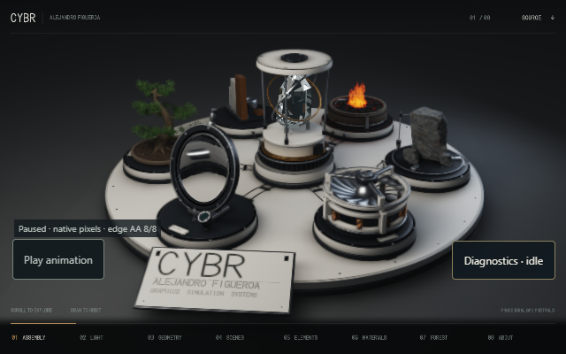
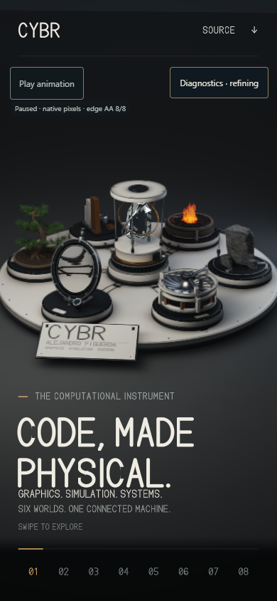

# Windows Instrument Rebuild portability evidence
Verified 22 October 2026 from imported commit 432800dc9c65a7f27d50d3cf82d398bf384bc80d plus this portability branch.

These are actual Chromium canvas/UI captures on Windows with Intel UHD graphics through ANGLE D3D11. Desktop640x400 and emulated touch390x844 both loaded, produced nonblank pixels, completed eight paused raster coverage samples, navigated by keyboard, kept the diagnostics control in view, and recorded no WebGL/uncaught JavaScript errors or external requests. The portrait controls now sit below the header, clear of the title. This is not a physical phone or mobile FPS benchmark.

Reproduction from the repository root:

    python -m pip install --no-compile numpy Pillow playwright
    python -m playwright install chromium
    python -m unittest discover -s tests -v
    python restore_assets.py
    python instrument-rebuild/build.py
    python instrument-rebuild/studio/audit_geometry.py
    cmake -S . -B output/native-build
    cmake --build output/native-build --config Release --parallel 2
    ctest --test-dir output/native-build -C Release --output-on-failure
    python tools/browser_smoke.py

Windows observations: six cache safety tests pass; all nine original cache hashes restore exactly on a drive without hard links; standalone HTML rebuilds; nine geometry checks pass; MSVC19.44 builds both native bakers. CTest runs both bakers with one and two threads on one synthetic triangle: outputs are deterministic and geometry bytes remain unchanged. It does not rebake the full scene. The final two-viewport browser check took159.7s under concurrent machine load.

The earlier cache hard-link failure is fixed only for Windows unsupported-link errors1/50. Access denial still fails, conflicting destinations are preserved, and transport hashes remain mandatory. The latest build is75,270,992bytes; see build-info.json. Imported build-info and historical verification records remain unchanged. Compression/runtime versions can change HTML bytes without changing the verified imported caches.

[Machine-readable browser report](report.json). The three-OS CI workflow has been configured, but no remote Linux/macOS/Windows job result is asserted here. The later Causal Bench source remains separately pending inspection/import. Full cache regeneration, physical Adreno stability,60FPS and hardware/physics qualification remain unverified. Original source/math sampling and licenses are preserved.
